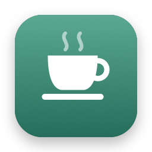
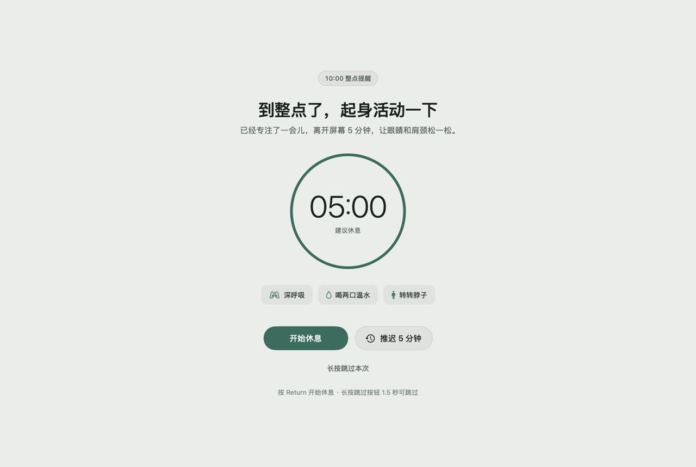
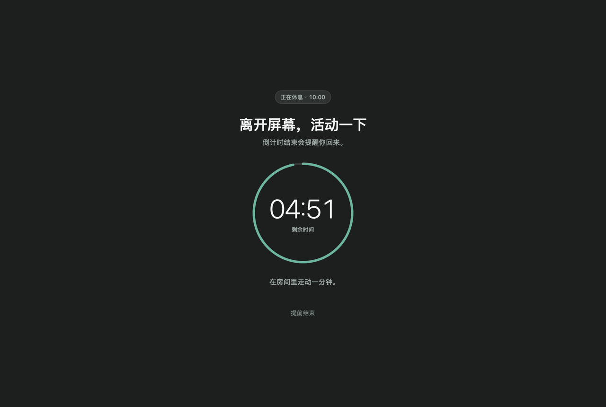
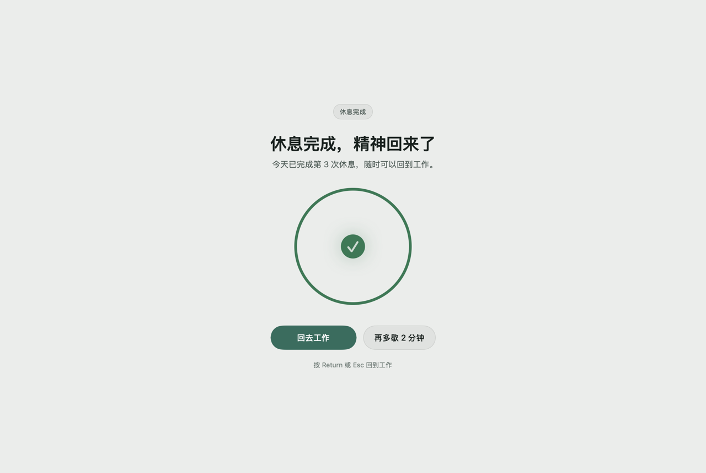
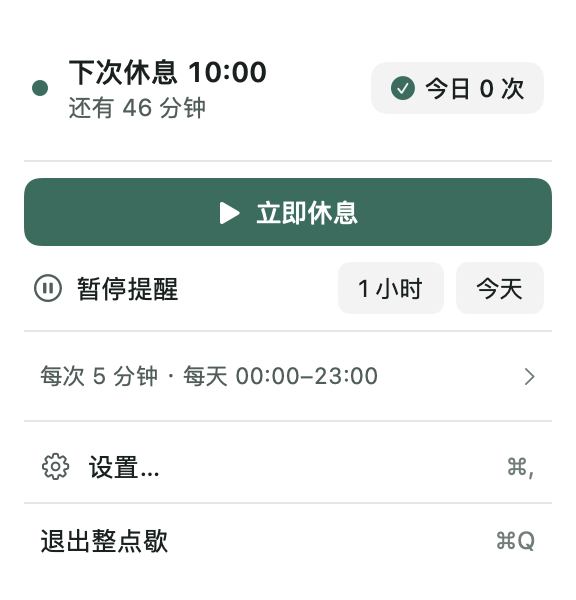
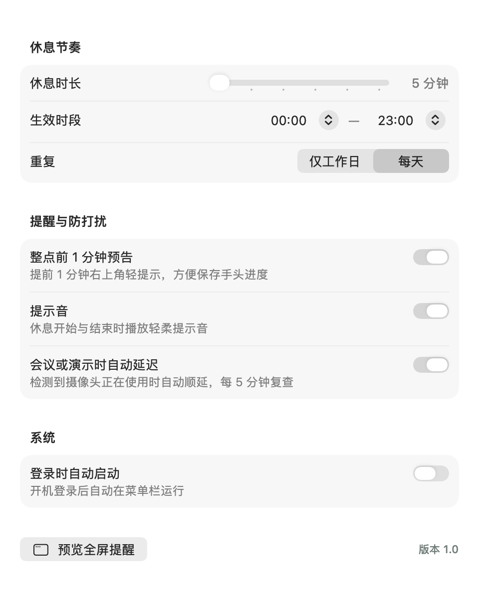
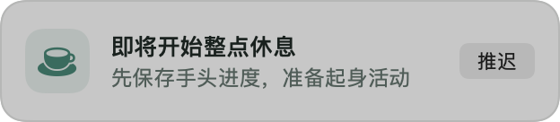

<p align="center"></p>

<h1 align="center">整点歇 HourRest</h1>

<p align="center">每到整点，温和而坚定地提醒你起身活动 5–10 分钟的 macOS 菜单栏小工具。</p>

> **English** — HourRest is a tiny, native macOS menu bar app that covers your screen at the top of every hour and asks you to get up and move for 5–10 minutes. A calm full-screen overlay with a one-minute heads-up, limited snoozes and a hold-to-skip button. Pure AppKit + SwiftUI, no dependencies, MIT licensed. The UI is in Simplified Chinese.



| 休息中（深色） | 休息完成 |
|---|---|
|  |  |

| 菜单栏面板 | 设置 |
|---|---|
|  |  |

整点前 1 分钟的预告小窗：



## 特点

- **整点全屏提醒**：覆盖所有显示器，光标所在屏可操作，其他屏只显示倒计时；在全屏应用里也会原地出现。
- **提前 1 分钟预告**：右上角小窗，不抢焦点，留时间保存手头的工作。
- **不容易被随手关掉**：Esc 关不掉；跳过要长按 1.5 秒（键盘和 VoiceOver 用户改为二次确认）；同一次提醒最多推迟 2 次。
- **识趣**：摄像头在用（开会）时自动顺延；刚休息完 15 分钟内不再提醒；合盖错过的整点不补弹；可暂停 1 小时或今天。
- **小而原生**：零依赖，菜单栏常驻、无 Dock 图标，跟随系统浅色 / 深色、减弱动态效果、降低透明度。

## 安装

需要 macOS 14 及以上（Apple 芯片和 Intel 均可）。

### 下载

到 [Releases](https://github.com/zuijiaosy/HourRest/releases/latest) 下载 `HourRest-x.y.z.zip`，解压后把 `HourRest.app` 拖进「应用程序」。

应用没有经过 Apple 公证，第一次打开会被 Gatekeeper 拦下。在终端执行一次下面的命令即可正常打开：

```sh
xattr -dr com.apple.quarantine /Applications/HourRest.app
```

也可以先双击打开一次，再到「系统设置 → 隐私与安全性」底部点「仍要打开」。

### 从源码编译

```sh
git clone https://github.com/zuijiaosy/HourRest.git && cd HourRest
./scripts/build-app.sh --install   # 编译并安装到 /Applications
open /Applications/HourRest.app
```

应用使用本机 ad-hoc 签名，自己编译安装不会触发 Gatekeeper。

「登录时自动启动」需要从 `.app` 运行，在设置窗口里打开。

## 开发

需要 Swift 6.0+。只装 Command Line Tools 就够，不需要 Xcode。

```sh
swift build                 # 编译
./scripts/test.sh           # 单测（Swift Testing）；脚本会补上只装 CLT 时缺的框架路径
./scripts/build-app.sh      # 打包 build/HourRest.app
swift scripts/make-icon.swift   # 重新生成应用图标
./scripts/release.sh        # 打包发布用的通用二进制 build/HourRest-<版本>.zip
```

### 不用等一个小时：调试模式

```sh
open build/HourRest.app --args -debugIntervalMinutes 2 -debugBreakSeconds 20
```

每 2 分钟提醒一次，休息 20 秒，推迟 1 分钟，忽略生效时段，关闭冷却与合并。也可以在设置窗口点「预览全屏提醒」，预览不计入次数。

### 界面截图（仅 debug 构建）

```sh
swift build && .build/debug/HourRest -snapshotDir /tmp/hourrest-shots
```

把全屏层各状态、菜单栏面板、预告小窗、设置窗口的浅色 / 深色版本离屏渲染成 PNG 后退出，不会弹出任何窗口。

### 排查「没有提醒」

```sh
/usr/bin/log show --last 2h --predicate 'subsystem == "io.github.zuijiaosy.HourRest"' --info
```

会列出每次算出的下一次提醒、触发、跳过原因（休眠错过 / 会议顺延 / 用户操作）。在 zsh 里要写 `/usr/bin/log`，否则会调用 shell 自带的同名命令。

### 手动测试清单

| 场景 | 预期 |
|---|---|
| 整点前 1 分钟 | 右上角出现预告小窗，不抢焦点；菜单栏图标变实心并显示 `1m` |
| 预告上点「推迟」 | 推迟到整点后 5 分钟，算一次推迟 |
| 整点到达 | 所有显示器全屏；光标所在屏有按钮，其他屏只显示倒计时 |
| 正在别的应用里打字时弹出 | Return 开始休息；按键不会漏进被挡住的编辑器 |
| 按 Esc（提醒 / 休息中） | 不关闭；有确认条时只收起确认条 |
| 单击「长按跳过本次」/ 按住后拖出按钮 | 不跳过；按住 1.5 秒才跳过 |
| Tab 聚焦跳过按钮后按空格或 Return | 出现「确定跳过这次休息？」确认条 |
| 推迟两次后 | 推迟按钮变成「已达推迟上限」并置灰 |
| 休息倒计时结束 | 完成态，计数 +1；Return 或 Esc 回到工作 |
| 暂停 1 小时 / 今天，再点一次 | 图标变 `moon.zzz` 并半透明；再点同一项取消暂停 |
| 合盖休眠后唤醒 | 错过的整点不补弹；离下个整点不到 3 分钟时，推迟到唤醒后 5 分钟 |
| 打开摄像头（开会） | 整点提醒顺延，每 5 分钟复查 |

## 代码结构

```
Sources/HourRestCore/Schedule.swift   纯逻辑：下个整点、生效时段、暂停、推迟合并、冷却、唤醒缓冲（有单测）
Sources/HourRest/
  ReminderEngine.swift      状态机：空闲 → 预告 → 全屏 / 推迟 / 会议顺延；每秒按绝对时间检查，不会漂移
  RestSession.swift         单次全屏提醒：提醒到达 → 休息中 → 完成
  OverlayController.swift   多显示器全屏非激活面板、热插拔、Esc 拦截
  OverlayViews.swift        全屏层界面、长按跳过
  PreAlertController.swift  整点前 1 分钟预告
  StatusBarController.swift 菜单栏图标与弹出面板
  SettingsWindow.swift      设置窗口
  SettingsStore.swift       设置持久化、开机自启动（SMAppService）
  MeetingDetector.swift     摄像头占用检测（CoreMediaIO，不需要权限）
  Theme.swift               配色 Token 与通用组件
docs/DESIGN.md              设计规范与已定决策
```

## 已知限制

- 会议检测只看摄像头是否被占用，纯语音会议、屏幕共享、不开摄像头的演示检测不到。没有检测麦克风：常驻的语音类应用容易造成误判，让提醒一直被顺延。
- 默认每天 00:00–23:00 每个整点都提醒，可在设置里缩小时段或改成仅工作日；时段首尾两个整点都会提醒。
- 界面只有简体中文。

## 参与

欢迎提 Issue 和 PR。这个项目刻意保持小：新功能请先开 Issue 讨论。提交前请跑一遍 `./scripts/test.sh`，改了界面的话附上 `-snapshotDir` 生成的截图。

## 许可

[MIT](LICENSE)
